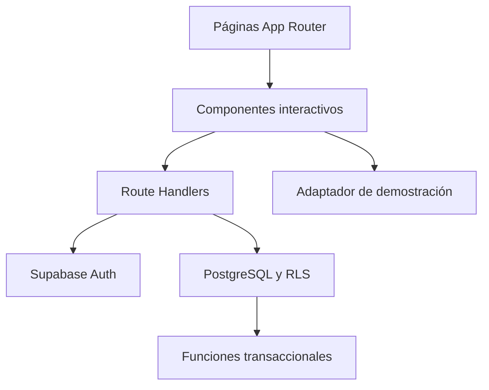

# AgroControl

Aplicación web para estandarizar el catálogo, inventario y ventas de una empresa distribuidora de fertilizantes. Proyecto académico funcional con Next.js 16.4.5, App Router, TypeScript, React, CSS Modules y Supabase (Auth + PostgreSQL).

**Repositorio público:** pendiente de crear desde tu cuenta.

**Aplicación en producción:** pendiente de desplegar y agregar la URL real.

## Qué incluye

- Inicio de sesión por correo y contraseña y recuperación de contraseña.
- Perfiles de administrador, ventas, bodega y lectura, controlados en la base de datos.
- Productos con código único, categoría, presentación, unidad, precio, mínimo y estado activo/inactivo.
- Clientes y proveedores con edición y desactivación.
- Entradas y salidas de inventario con cantidad, motivo, proveedor opcional y responsable.
- Ventas con varios productos, total calculado por el servidor y descuento de stock en una sola transacción.
- Anulación con motivo, devolución de stock y conservación del historial.
- Resumen mensual, alertas de stock bajo, gráfico semanal y movimientos recientes.
- Reportes con fechas y exportación CSV de existencias, ventas y movimientos.
- Demo independiente con datos ficticios para explorar sin configurar cuentas.

## 1. Ejecutar en Windows

Instala **Node.js 24 LTS** desde https://nodejs.org. Reinicia PowerShell o VS Code después de instalar. Instala Git para publicar el repositorio.

Extrae todo el ZIP, abre `agrocontrol` en VS Code y selecciona Terminal → Nueva terminal. Debes ver `package.json` al ejecutar `Get-ChildItem`; no ejecutes los comandos dentro de `src`.

```powershell
node --version
npm --version
npm ci
Copy-Item .env.example .env.local
npm run dev
```

Abre http://localhost:3000 y selecciona **Abrir demostración**. Mantén la terminal abierta. Detén el servidor con Ctrl+C.

En Linux/macOS sustituye `Copy-Item` por `cp`. Si PowerShell bloquea `npm.ps1`, usa `npm.cmd ci` y `npm.cmd run dev`. No necesitas cambiar las políticas del equipo.

## 2. Datos reales compartidos

Sigue [docs/CONFIGURAR_SUPABASE.md](docs/CONFIGURAR_SUPABASE.md). Debes crear un proyecto Supabase, ejecutar la migración incluida, crear tus usuarios y asignarles un rol. Después configura `.env.local`, reinicia el servidor y sal de la demo para iniciar sesión.

```dotenv
NEXT_PUBLIC_SUPABASE_URL=https://TU_PROYECTO.supabase.co
NEXT_PUBLIC_SUPABASE_ANON_KEY=TU_CLAVE_PUBLISHABLE_O_ANON
```

Estas variables son públicas por diseño: la seguridad depende de Auth, permisos y RLS. **No uses claves secretas ni service_role.** Nunca subas `.env.local` a GitHub. Si en una evolución agregas secretos del servidor, usa variables sin prefijo `NEXT_PUBLIC_`.

Una empresa por proyecto Supabase. Los usuarios autorizados de esa empresa comparten los datos. No es una plataforma multiempresa.

## 3. Flujo inicial recomendado

1. Administración registra productos; cada presentación debe tener su código y unidad.
2. Ventas o administración registra clientes y proveedores.
3. Bodega registra saldos iniciales como entradas con referencia y motivo.
4. Ventas crea una venta seleccionando el cliente y los productos.
5. El sistema descuenta stock y registra movimientos con responsable.
6. Si hubo error, anula la venta e indica el motivo. No registres además una entrada manual por la misma anulación.
7. Consulta indicadores y exporta CSV.

La demostración permite este mismo recorrido, pero guarda datos ficticios localmente. Restablecer demo elimina únicamente esos datos locales. No hay importación automática de Excel ni traslado automático de la demo a Supabase.

## 4. Arquitectura

| Capa | Implementación |
|---|---|
| Páginas y layout | Server Components de App Router |
| Interacción | Client Components con `useState`, `useEffect`, contexto y formularios |
| Estilos | `ui.module.css` y resets globales |
| API | `GET /api/data` y `POST /api/commands` mediante fetch |
| Validación | Zod en Route Handler, restricciones y reglas en PostgreSQL |
| Identidad | Supabase Auth; verificación `getUser` en el servidor |
| Autorización | Perfiles, RLS y funciones que vuelven a comprobar el rol |
| Persistencia real | PostgreSQL de Supabase |
| Persistencia demo | Adaptador local en `localStorage` |
| Pruebas | Node Test Runner, TypeScript y PostgreSQL embebido PGlite |



Las páginas no exponen datos del negocio en HTML estático. El cliente solicita la información a la API autenticada. Los Server Components aportan estructura, composición y metadatos; las consultas operativas se hacen desde Client Components a los handlers.

### Rutas

`/`, `/productos`, `/inventario`, `/contactos`, `/ventas`, `/reportes`, `/guia`, `/recuperar`, además de dos rutas API. La pantalla de acceso se muestra cuando no hay sesión ni demo. La protección efectiva de datos y operaciones está en la API y PostgreSQL, no solo en ocultar botones.

### Reglas de inventario

- No se permiten existencias negativas.
- Una venta completa se confirma o revierte en una sola transacción.
- Bloqueos de filas protegen la actualización del stock. Los productos se bloquean en orden consistente.
- Identificadores de operación únicos evitan duplicar entradas o ventas al reintentar una misma solicitud.
- Una venta solo se puede anular una vez.
- No se pueden cambiar unidades después de registrar movimientos.
- Los precios y unidades de cada venta quedan como instantánea en su detalle.
- Productos/contactos se desactivan; ventas se anulan. No se borran movimientos desde la aplicación.

## 5. Verificar el proyecto

```powershell
npm test
npm run typecheck
npm run build
npm start
```

`npm start` necesita el build previo. `npm test` utiliza PostgreSQL embebido y no requiere tus credenciales ni toca la base de Supabase. Prueba migración, permisos, RLS, transacciones, idempotencia, anulaciones y validación. PGlite no sustituye una prueba de concurrencia ni una prueba de integración contra tu proyecto real.

Para revisar la UI y la configuración real sigue [docs/PRUEBAS_MANUALES.md](docs/PRUEBAS_MANUALES.md). Los resultados ejecutados se registran en `VALIDACION.md`.

## 6. Publicar en GitHub conservando commits

El ZIP incluye `.git` y `historial-desarrollo.bundle`. Los commits fueron hechos por el asistente durante la implementación; agrega tus revisiones reales. El bundle sirve si tu descompresor omite carpetas ocultas.

1. Crea un repositorio **público y vacío** en https://github.com/new. No agregues README, gitignore ni licencia desde GitHub.
2. En la carpeta del proyecto:

```powershell
git log --oneline
git branch -M main
git remote add origin https://github.com/TU_USUARIO/agrocontrol.git
git push -u origin main
```

Si no aparece el historial, recupéralo en una carpeta nueva:

```powershell
git clone .\historial-desarrollo.bundle ..\agrocontrol-git
cd ..\agrocontrol-git
git remote remove origin
git remote add origin https://github.com/TU_USUARIO/agrocontrol.git
git push -u origin main
```

Para registrar tus mejoras, después de probarlas:

```powershell
git add .
git commit -m "feat: describir mi mejora concreta"
git push
```

El bundle no incluye dependencias: en un clon nuevo ejecuta `npm ci` y copia `.env.example` a `.env.local`.

## 7. Desplegar en Vercel

1. Configura y prueba Supabase localmente siguiendo la guía.
2. Sube el código a tu GitHub público.
3. En https://vercel.com inicia sesión con GitHub e importa el repositorio.
4. Framework: Next.js. Root Directory: donde está `package.json`. Build: `npm run build`. Node.js: 24.x. No uses exportación estática: necesitas Route Handlers.
5. Agrega las dos variables de `.env.example` en Environment Variables para Production. No adjuntes `.env.local` al repositorio.
6. Pulsa Deploy. Configura después la URL real en Supabase Authentication → URL Configuration, según la guía.
7. Prueba la URL pública: acceso, lectura, entrada, venta, anulación y permisos. La URL será pública, pero los datos reales requerirán inicio de sesión.
8. Sustituye los dos campos pendientes al inicio de este README por las URLs reales de GitHub y Vercel. Confirma y publica el cambio.

No se ha creado ni publicado un repositorio en tu cuenta. No se inventa una URL de producción. Esos entregables requieren completar estos pasos con tus cuentas. Esta publicación en Vercel no sustituye la otra actividad que exige AWS.

## 8. Alcance y límites

- Es una aplicación académica para una distribuidora comercial. No incluye producción, recetas de mezcla, lotes, vencimientos, varias bodegas, compras con cuentas por pagar, facturación fiscal ni contabilidad.
- Moneda USD. Fechas mostradas en America/El_Salvador. Cantidades hasta 3 decimales; precios hasta 2. No hay impuestos ni descuentos.
- El precio se expresa por la unidad de inventario. “Saco de 50 kg” se cuenta en sacos: no se convierte automáticamente a kg.
- El valor comercial es stock × precio de venta; no es costo contable ni utilidad.
- La UI carga hasta 200 movimientos y 200 ventas recientes. Los reportes y el gráfico usan ese conjunto; el total mensual consulta todo el historial en SQL. Los CSV no son un respaldo integral.
- El catálogo admite menos de 1,000 productos y menos de 1,000 contactos en esta versión. Si alcanza ese límite, se muestra un error explícito y debe ampliarse la paginación.
- No hay actualización en tiempo real. Usa Actualizar para traer cambios de otros usuarios.
- La demo se guarda en un solo navegador y no garantiza coordinación entre pestañas. No uses datos reales en ella.
- Sin las hojas reales de la empresa, no se ha realizado mapeo ni migración. `plantillas/catalogo_productos.csv` es una referencia de estandarización, no un archivo de importación implementada.
- Antes de usarla en operación real deben validarse los procesos, respaldos, necesidades de trazabilidad y la integración en el proyecto Supabase de la empresa.

## Problemas frecuentes

| Problema | Solución |
|---|---|
| `npm` no se reconoce | Instala Node.js y abre otra terminal |
| Falta `package.json` | Entra a la carpeta agrocontrol, no a src |
| Puerto 3000 ocupado | `npm run dev -- --port 3001` y abre ese puerto |
| Usuario sin acceso | Asigna el perfil mediante SQL; crear el usuario no asigna rol automáticamente |
| No puede leer datos | Verifica variables, migración y perfil; reinicia el servidor tras cambiar `.env.local` |
| Cambié variables y no se refleja | Reinicia `npm run dev`; en Vercel realiza un nuevo despliegue |
| Recuperación no llega | Revisa URL permitida, configuración de correo de Supabase y carpeta de spam |
| Falla la actualización después de guardar | Pulsa Actualizar y comprueba el historial antes de repetir la operación |

## Documentación

- `docs/CONFIGURAR_SUPABASE.md`: base, usuarios y variables.
- `docs/REQUISITOS_TAREA.md`: correspondencia con el enunciado.
- `docs/PRUEBAS_MANUALES.md`: recorrido de validación.
- `VIBE_CODING.md`: decisiones, iteraciones y registro honesto de IA.
- `VALIDACION.md`: verificaciones ejecutadas y pendientes.

Fuentes técnicas: https://nextjs.org/docs/app · https://supabase.com/docs/guides/database/postgres/row-level-security · https://supabase.com/docs/reference/javascript/auth-getuser · https://vercel.com/docs/frameworks/full-stack/nextjs
